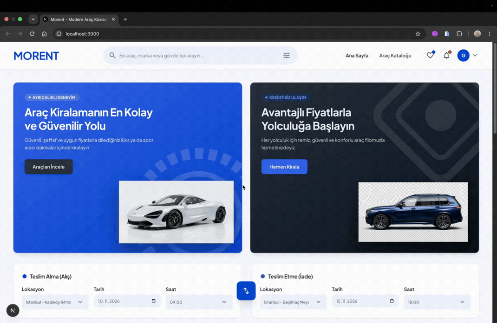

# 🚗 Morent - Modern Car Rental Platform

**Morent** is a modern, full-stack car rental application built with Next.js 15 (App Router), TypeScript, and MongoDB. Designed with a sleek user interface and smooth user experience, it features dynamic vehicle filtering, user authentication, and seamless booking management.

---

## 📸 Proje Ekran Görüntüsü / Demo

---

 

---

## ✨ Key Features

- **⚡ Next.js 15 App Router Architecture:** Server-side rendering (SSR), static site generation (SSG), and Server Actions for optimal performance.
- **🔐 Secure Authentication:** Seamless user login and sign-up with NextAuth.js (Credentials & OAuth support).
- **🚗 Dynamic Vehicle Catalog:** Advanced search filtering by car category, seating capacity, price range, and keyword.
- **📅 Interactive Booking Flow:** Real-time availability checks, date selection, and reservation submission.
- **🌗 Responsive Design:** Fully mobile-friendly layout built with Tailwind CSS.
- **📊 Admin Dashboard:** Track booking statistics, manage rental inventory, and monitor user reservations.

---

## 🛠️ Tech Stack

### **Frontend**

- **Framework:** Next.js 15 (App Router)
- **Language:** TypeScript
- **Styling:** Tailwind CSS, Lucide Icons
- **State Management:** React Context API

### **Backend & Database**

- **Database:** MongoDB
- **ORM / ODM:** Mongoose
- **Authentication:** NextAuth.js (Auth.js)
- **API Architecture:** RESTful Endpoints & Next.js Server Actions

---

## 🚀 Getting Started

###

## 👩‍💻 Software Developer

### Helin Çelikbaş
